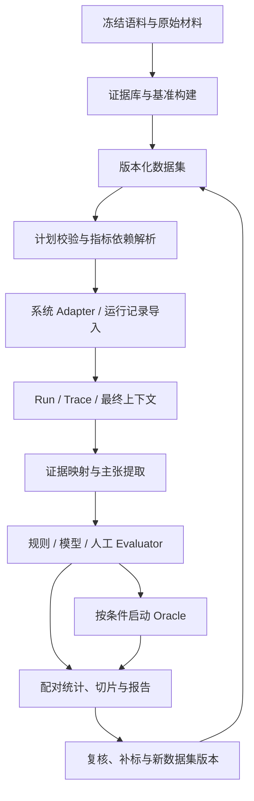

# 全链路 RAG 自动化测评框架与基准数据集构建技术设计方案 v2

| 项目 | 内容 |
|---|---|
| 文档版本 | 2.0 |
| 编写日期 | 2026-11-06 |
| 文档定位 | 可独立阅读的完整技术设计，作为后续实现与验收基线 |
| 适用场景 | 企业知识库，文本及富文本/多模态 RAG，组件比较、离线回归、线上监控 |
| 首版形态 | 轻量评测协调层、标准数据契约、可插拔 Adapter/Evaluator、文件报告 |
| 核心目标 | 测量可信、实验可比、结果可审计、失败可复查 |
| 参考依据 | 文末已核对的一手来源；具体工具接入需固定版本并在业务域验证 |

本方案将全链路评价与分期实现统一设计。首版建立可靠闭环；高级定位、通用阶段干预、复杂 agent 轨迹与统计成本优化通过插件扩展。文中的接口和 JSON 是框架契约示例，不代表已有代码实现或已审定业务数据。

## 目录

1. 目标、原则与实施边界
2. 术语及评价边界
3. 总体架构与模块职责
4. 数据模型、版本与产物管理
5. 稳定证据定位与运行映射
6. 基准数据集构建
7. 接入接口与能力声明
8. 指标契约、依赖与状态
9. 全链路指标体系
10. 多模态证据与评价
11. 自动裁判及共模偏差治理
12. 执行模式与调度流程
13. 诊断及 Oracle 对照
14. 对比统计、报告与发布门禁
15. 线上监控与数据回流
16. 工程实现、安全与成本
17. 核心数据契约示例
18. 分期交付与验收
19. 主要风险及处置
20. 参考来源

## 1. 目标、原则与实施边界

### 1.1 要解决的问题

框架面向三个问题：

1. 系统是否按任务要求给出正确、完整、有证据且符合权限策略的结果。
2. 修改解析、切块、索引、检索、重排、上下文组装或生成配置后，收益和代价能否在同一把尺子下比较。
3. 错误发生时，能否定位证据在哪个阶段丢失，或通过受控对照增加对故障假设的支持。

主要使用者为 RAG 开发、数据与算法工程师，以及评审发布质量的负责人。报告同时提供业务成功视图和组件诊断视图。

### 1.2 设计原则

- **参考稳定**：gold 绑定不可变源文与独立参考，不绑定某次切块的 chunk ID。
- **实现解耦**：被测系统可保持内部实现；能测什么由实际开放的数据和接口决定。
- **概念分离**：正确、完整、相关、忠实、充分、引用有效和正确拒答独立评价。
- **预算可比**：同任务、语料、权限、时间与资源口径下比较；跨切块优先固定上下文预算。
- **不确定性显式化**：缺字段、未知标签、裁判分歧和执行错误都有状态，不静默删样本。
- **人工与自动结合**：规则和模型扩展覆盖，人工核心集提供独立核验及裁判校准。
- **诊断分层**：观察提供线索，干预评估影响；不把单次对照包装为唯一根因证明。
- **按需复用**：采用已有追踪、指标和实验执行能力，自研证据映射、可比规则和业务约束。

### 1.3 首版边界

| 能力 | 首版必须具备 | 首版可选/后续 |
|---|---|---|
| 数据治理 | 语料/数据集/配置/裁判版本，基础审定核心集 | 更复杂审批和自动标注调度 |
| 定位 | 固定原文 quote、文档版本、范围与消歧信息 | 全格式全局字符对齐、精细 bbox |
| 接入 | E2E 调用或导入，基础 Trace 数据契约 | 指定上下文生成；任意阶段回放 |
| 测量 | 主张、任务结果、证据覆盖、拒答、成本延迟 | 解析专项、视觉定位等高级插件 |
| 对比 | 配对实验、切片、区间、测量覆盖 | 大规模配置自动搜索 |
| 执行 | 顺序/有限并发作业、显式重试与恢复 | 通用 DAG 调度、持久化业务工作流 |
| 统计校准 | 人工校准、混淆矩阵、偏差检查 | PPI、复杂主动采样 |

缺少某项接入能力时，相关指标显示不可计算。基础 E2E 接入不以开放全部内部阶段为前提。首版不承诺无人工真值、不承诺零接入成本的全链路归因，也不预设任何一种 RAG 算法优于其他算法。

## 2. 术语及评价边界

| 术语 | 本方案定义 |
|---|---|
| CorpusSnapshot | 指定源文版本、有效时间和访问规则的冻结语料清单 |
| SourceArtifact | 原始文件、冻结渲染页、图像、表格及其派生产物 |
| EvidenceUnit | 可回到源文的一项证据，含必要的实体、期间、条件和数值关系 |
| Claim | 可验证主张；参考答案主张与模型输出主张分别保存 |
| SufficientEvidenceSet | 在任务规则下足以作答的一组证据；组内不同必要事实均需覆盖，同事实的审定来源可替代，不同充分组也可替代 |
| Chunk | 待测系统的运行/索引单元，不作为跨配置通用黄金证据身份 |
| Qrels | query 与固定检索评价单元之间的相关度标注 |
| FinalContext | 实际发送给某次生成调用的内容及顺序，含文本、图像和工具结果 |
| Judgment | 对一次运行或产物的某个维度作出的判断，含版本、状态及依据 |
| Answerability | 相对于指定语料、时间、权限和允许工具的答案可得性 |
| Oracle 对照 | 将指定生成调用的上下文换成审定充分证据的受控试验 |

评价边界如下：

- **正确性**检查答案事实与任务结果；语义相似度只作辅助，不直接等于正确。
- **忠实度**检查主张是否受实际输入支持；高忠实度不保证源文真实，也不保证答全。
- **充分性**检查当前证据是否足以支持完整作答；主题相关不代表充分。
- **引用支持**检查该主张标出的来源；正文受某处材料支持，不等于引用位置正确。
- **可答性**是用例和环境的属性；检索失败不能自动改变 gold 可答性。
- 事实真值可能随时间变化；正确性以用例指定的有效时间和业务规则为准。

任务成功由固定 rubric 定义。可回答题要求正确、必要信息完整及规定的证据/策略约束；无答案或无权限题可将正确拒答定义为成功，需在报告中按 expected_action 分层。

## 3. 总体架构与模块职责

### 3.1 逻辑架构



线上流量通过相同 Trace/Judgment 契约进入监控与复核队列。线上数据不会未经审定自动写入冻结 gold。

### 3.2 模块职责

| 模块 | 输入/输出与职责 |
|---|---|
| Dataset Builder | 源文、关系与场景 → 候选问题、证据、答案规则；不负责将模型一致性当真值 |
| Dataset Registry | 版本发布、split、审定状态、标签覆盖、变更记录 |
| Artifact Store | 原文件、渲染、上下文、图像、请求和索引信息的内容寻址存储 |
| Adapter Registry | 接入能力、系统版本、阶段输入输出和调用限制 |
| Experiment Runner | 校验计划、执行/导入、超时重试、资源预算、结果持久化 |
| Evidence Mapper | 稳定证据到 parser/chunk/候选/最终上下文的映射及不确定状态 |
| Metric Planner | 按依赖与适用条件产生任务，不臆测缺失字段 |
| Evaluator Registry | 规则、主张提取、judge 和人工反馈插件的版本管理 |
| Diagnostic Engine | 症状、故障假设、Oracle 对照及观察到的影响 |
| Report/Gate | 配对统计、切片、覆盖与错误、门禁 pass/fail/inconclusive |
| Review Queue | 分歧、未知替代证据、映射失败和线上案例的复核 |

首版可作为一个 Python 包与 CLI 运行，逻辑模块不要求拆成微服务。参考实现采用 Python 3.11+、类型化数据校验、JSONL/JSON/YAML 产物；这些是实施默认选择，不是被测系统技术栈限制。

### 3.3 追踪图不等于调度引擎

报告保留七阶段视图：解析清洗 → 切块 → 表征索引 → 查询处理 → 检索重排 → 组装生成 → 工程安全。

循环检索、并行搜索和多次生成以多个 span 表示，含 parent/link 和 attempt。框架先记录真实执行关系，不负责重新实现被测业务的工作流。离线解析、切块和索引只记录构建产物与配置谱系，不在每次查询时重做。

## 4. 数据模型、版本与产物管理

### 4.1 核心对象

| 对象 | 核心字段 |
|---|---|
| CorpusSnapshot | snapshot_id、文件 revision/hash、有效时间、访问策略版本 |
| SourceArtifact | artifact_id、来源 revision、类型、父产物、内容摘要、存储引用 |
| EvidenceUnit | evidence_id、来源、locator、事实属性、核验状态 |
| DatasetVersion | version_id、case_ids、split、标注/合成版本、审定范围和校验摘要 |
| TestCase | query/history、as_of、access_scope、expected_action、参考主张/规则、证据组、tags |
| SystemConfig | parser/chunker/embed/index/retriever/reranker/generator 等版本和参数 |
| ExperimentManifest | 数据/语料/系统/裁判/预算/环境/采样/比较规则的冻结快照 |
| RunRecord | case_id、配置、attempt、输出、状态、计量、trace 引用 |
| Span | stage、实际输入输出引用、时刻、父/链接、错误、usage |
| EvidenceMapping | evidence_id、stage/artifact、匹配方式、位置、状态、mapper 版本 |
| Judgment | metric/version、value/status、分母、依据、依赖、成本 |
| Intervention | baseline/oracle run、干预范围、固定条件、观测结果 |
| ComparisonReport | 配对集合、缺失原因、差异/区间、切片与门禁 |

参考内容与被测输入物理/逻辑隔离：常规 run 仅接收用户可见 query/history、访问范围和业务配置，不接收 reference answer、gold IDs、judge 结果。仅指定 Oracle 试验可显式注入 gold context。

### 4.2 发布与变更

数据集状态：

`draft → validated → reviewed → frozen → superseded`。

- 自动验证样本可发布冻结的 synthetic 版本，但不能自动标为 human_verified。
- 冻结后修改答案、来源、证据组、split 或 rubric，均产生新版本。
- 原文件改变产生新 revision/snapshot；gold 是否仍有效需要重新核验。
- 比较默认要求相同 dataset、snapshot、judge/rubric、mapper 和预算口径；不同版本仅作显式迁移分析。
- 修改 judge 后，旧 Run 可重新评分形成新 Judgment；原评分不覆盖。
- 同一 case 可跨版本保留身份，但内容变化须有 revision/变更记录。

### 4.3 产物保存

首版至少输出：

```text
datasets/<dataset_version>/
  manifest.json
  test_cases.jsonl
  evidence_units.jsonl
experiments/<experiment_id>/
  manifest.json
  runs.jsonl
  spans.jsonl
  evidence_mappings.jsonl
  judgments.jsonl
  interventions.jsonl
  comparison.json
  report.md
  artifacts/
```

大文件可存对象存储并引用内容摘要。JSONL 导出是可审计契约，可同时用 SQLite 或现有实验平台管理索引。上下文必须能还原实际顺序和内容；若合规策略只允许摘要，相关精细评价标为受限，不能把摘要伪装成原输入。

## 5. 稳定证据定位与运行映射

### 5.1 定位策略

文本首版采用 **文档 revision + 固定 quote + 可用范围 + prefix/suffix**。char_span 作为可选增强，必须指向固定 canonical 文本版本；不能引用每个待测 parser 各自变化的 offset。

表格定位保存参考表 ID、行列头/单元格、单位，已有可靠页/bbox 时附加。图像保存不可变 asset ID、源文 revision 与可靠位置，URL 只是访问地址。

PDF 以冻结页为准；DOCX 等可保存结构节点，或固定字体/渲染环境后产生带版本的页面产物。表格索引和 bbox 同样绑定参考侧，不能默认为 parser 预测即是真值。

约定：page 从 1 开始；bbox 为 [x0,y0,x1,y1]，原点左上，x 向右、y 向下，坐标归一化到 [0,1]；字符位置使用固定参考文本的 Unicode code point，半开区间 [start,end)。不支持的精度留空并声明 locator 类型。

### 5.2 映射流程

1. 校验 document_revision/asset identity 与访问范围。
2. 在可用页/章节/节点内精确匹配 quote。
3. 按固定 normalizer 版本保守处理空白等差异。
4. 必要时产生模糊候选，核查实体、期间、数字、单位、否定和比较符。
5. 用 prefix/suffix 消歧，保存一对多位置及跨 chunk 联合覆盖。
6. 输出状态与依据，缓存键包含源文、产物、normalizer、mapper 版本。

hash 用于完整性、去重和缓存，不负责模糊匹配。归一化不得消去年份差异、负号和单位等实质信息。quote 命中只证明文本位置，主张推导另由 evaluator 检查。

### 5.3 区分缺失与不可测

| 状态 | 定义及处理 |
|---|---|
| matched | 已可靠映射到具体产物/内容，位置与方法可查 |
| verified_absent | 已核验源文存在事实，但当前被测产物缺失；计入对应阶段真实缺失 |
| ambiguous | 多个位置/读法无法消歧；进入复核，显示测量覆盖 |
| unresolved | 当前匹配器不能确认存在或缺失；不得自动记 0/1 |
| not_applicable | 用例或产物类型不适用该映射 |

必须标注检查的是全量 parser 输出、索引全集、候选集还是最终上下文。源文可确认而 parser 丢失是解析缺陷；索引中存在而最终上下文未出现是后续链路缺失；仅映射器不理解改写不构成漏检证明。

### 5.4 替代证据与标注范围

`sufficient_evidence_sets=[["E1","E2"],["E3","E4"]]` 是逻辑简写：任一组中的不同必要事实全部满足即可。计分按 fact_id 去重；同一事实的多个已审定来源是替代项，不增加分母。不同输入若需要联合推导，必须保留为不同前提，不能错误地归成一个 fact_id。每组记录充分性的审定状态和允许推理规则，正式存储见第 17 节。

核心集优先补充已发现替代组，合成扩展集不要求穷举。记录 `relevance_annotation_scope` 及实际审定范围。新发现但未标注的结果是 unjudged，不直接判无关；可汇入候选池补标，发布新版本后重算比较双方。

## 6. 基准数据集构建

### 6.1 三层数据产品

| 数据层 | 内容与用途 | 结论范围 |
|---|---|---|
| 人工审定核心集 | 原文独立核验，覆盖关键任务与已知错误；裁判校准、回归、门禁 | 样本少时区间可能宽，不声称代表全部流量 |
| 合成扩展集 | 自动生成并规则/模型核验；覆盖/压力/消融 | 保留 synthetic_verified 状态，不当成独立真值 |
| 线上回流集 | 真实 query、随机样本、失败/投诉/分歧 | 记录抽样来源与时间，避免以难例队列代表总体 |

没有既有人工标注时，先建设小规模审定种子集。若严格无人工预算，交付“自动验证候选集”并标记标签限制，不据其单独作高影响发布结论。题数按覆盖、目标差异和区间需要确定，不设通用固定门槛。

### 6.2 场景与覆盖矩阵

按多个正交维度采样：

- 任务：事实抽取、定义解释、比较、枚举、数值计算、真正多跳、开放总结。
- 输入：自然问句、关键词、缩写、错别字、指令、多轮指代。
- 模态：纯文本、表格、图表、扫描件、跨图文、跨文档。
- 约束：实体、期间/版本、否定、单位、访问权限。
- 行为：作答、正确拒答、澄清、允许的工具调用、冲突说明。
- 难度：必要事实数、跨文档跨度、逻辑依赖、噪声与候选竞争。

难度标签结合结构和基线表现，不只由生成器自评。

### 6.3 生成流水线

```text
冻结语料与独立参考样本
 → 源文结构/事实/条件/位置提取
 → 实体与证据关系
 → 场景采样
 → 候选 query + 必需主张 + 充分证据组 + 验证规则
 → 可答性、数值、依赖、来源与歧义核验
 → 跨模型分歧检测 + 人工抽检/仲裁
 → 去重、分组切分、版本发布
```

首版关系可用结构化表和规则表达，不要求部署图数据库。后续可复用 Ragas 的 KG/Scenario 生成：层级节点、extractor、relationship builder、query style/length 等。[11] 这服务于基准构建，不要求被测系统采用 GraphRAG。

生成用 parser 可帮助提候选，但人工核心集需回到原文件独立核查，并主动抽取 parser 易遗漏内容。禁止只从待测 parser 输出建全套 gold 来评 parser 自身。

### 6.4 真多跳与数值验证

多跳围绕实体链、跨期比较、定义—条件—结果或图表—正文关系建立。记录必要证据和推导依赖，检查移除某一跳后剩余证据是否仍充分；不能只靠两段向量相似或模型答错来证明必要性。

数值验证保存类型化输入、实体/期间/单位、允许操作、预期输出和容差。先核验输入及关系，再执行白名单运算。计算结果无须在原文逐字出现；OCR 找到同一数字也不自动证明行列、年份和业务线正确。

对无标签图表的估读，记录来源分辨率与绝对/相对容差；精确报表读取与估读任务分开。不能直接执行模型输出的任意代码。

### 6.5 负例、冲突与可答性

可答性至少区分 `answerable / unanswerable / ambiguous / conflicting / unknown`，并独立记录 expected_action 与原因。权限不足通过 access_scope 和 policy 标注，不以泄露不可访问答案作为成功。

负例相对于全授权语料快照和允许工具核验。当前锚点无答案不等于整库无答案；多检索策略候选检查加高影响样本人工确认。搜索无命中不足以证明无答案，不能确认时标 unknown。

使用最小修改的可答/不可答对照，避免负例仅靠明显句式可识别。允许工具时需说明工具是否能提供答案；检索失败不将原本可答的 query 改标为不可答。

### 6.6 切分与独立性

按文档族、实体、模板、会话或时间分组切分；同一原文派生的近重复问题不得随机散到 dev/test。记录题目分组和去重版本。

区分“问题留出”和“语料留出”：如果研究同一知识库内的问题泛化，测试用源文仍可位于检索库，但参考题和答案不得进入系统 prompt、索引或训练；若研究跨文档/领域泛化，另建立明确的语料划分。judge 调参与系统调参均不使用最终 holdout 标签。

基准质检报告输出候选数、各环节淘汰原因、审定状态、模态/任务分布、重复率、来源覆盖、未知标签和复核通过情况。

## 7. 接入接口与能力声明

### 7.1 能力清单

Adapter 注册时声明以下独立能力，不能由平台名称推断支持：

| Capability | 含义 |
|---|---|
| e2e_run | 按用户输入执行系统，返回标准 Run |
| import_run | 导入已有运行/生产记录 |
| retrieve_only | 不调用生成器，返回检索/重排阶段产物 |
| trace_stages | 提供实际阶段、顺序、内容与计量 |
| generation_context | 提供实际生成输入及对应配置 |
| generate_with_context | 复用原生成阶段，接受指定上下文 |
| offline_artifacts | 提供 parser/chunk/index 构建产物与谱系 |
| multimodal_input | 输入包含原始图像/页面等内容 |
| stage_replay | 后续扩展：明确列出的阶段可注入并重执行 |

E2EAdapter 是执行或导入入口；TraceAdapter 是记录能力；首版 OracleAdapter 只封装 generate_with_context。ReplayAdapter 保留为后续扩展，不要求任意内部状态热插拔。

### 7.2 语义接口

```text
describe() -> AdapterCapabilities

run(user_input, history, access_scope, system_config, run_context)
  -> RunRecord

retrieve_only(user_input, history, access_scope, retrieval_config, run_context)
  -> RetrievalArtifacts

import_run(external_record, mapping_config)
  -> RunRecord

generate_with_context(user_input, history, access_scope,
                      supplied_context, original_generation_config, run_context)
  -> GenerationRecord
```

以上为语言无关契约，类型由 schema 定义。只有支持的接口才必须实现。接入时验证参数、配置摘要、权限和超时，不依赖反射调用未声明功能。

### 7.3 运行记录要求

最低记录 query/history 引用、case/config IDs、run status、最终 answer/action。需要哪些指标，再补相应阶段数据。

检索记录至少包含 query 变换、候选 ID/来源 revision、rank、score/score_type、内容引用和过滤范围。各检索路线的原始分数保留类型，融合后另记排序，不能直接比较不同模型裸分值。

生成记录保存实际消息/模板渲染结果、文本和图片顺序、工具结果、上下文截断、token/图像预算、模型/采样配置及输出。不能以重构 prompt 代替“实际发送内容”。

Run 状态为 `succeeded / failed / timed_out / cancelled`。重试保留各 attempt 和成本；最终失败是系统表现，不按“缺少答案”从任务成功率中删除。对分布式阶段，使用各进程单调时钟计时并记录跨进程关联；不简单相加所有并行 span 充当 E2E。

### 7.4 预算契约

预算至少分离：

- 最终生成上下文文本 token 上限、计数 tokenizer/version，以及引用包装是否计入。
- 最大图像数、分辨率/像素预算和已知的 provider 计费口径。
- 检索候选数、重排数量、最大检索/工具轮次。
- 输出 token、请求 deadline、单用例/整次实验成本上限。
- 硬件/并发/冷热缓存与索引构建资源。

同一文本 RAG 比较使用同一 tokenizer 和上下文口径；更换生成模型时同时记录各模型实际用量，承认 tokenizer/能力差异。不同模态不把“相同文本 token”宣称为相同总资源，应报告质量—延迟—成本曲线和多维预算。

## 8. 指标契约、依赖与状态

### 8.1 MetricSpec

每个指标登记：metric_id、version、评价单位、requires、适用条件、取值/方向、分母、聚合、阈值来源、实现/裁判、去重和 unknown 策略。

同名指标如使用不同粒度、分母或 judge，必须产生不同 metric version/profile。预处理、主张提取、证据映射也属于依赖版本。第三方指标导入先显式转换，不直接混入本方案定义。

### 8.2 依赖示例

| 指标 | 最少数据依赖 |
|---|---|
| E2E/TTFT/usage | 实际时间戳和计量；TTFT 需流式输出 |
| Correctness/Completeness | answer、审定参考主张或可执行规则、task rubric |
| Groundedness | 输出主张、实际生成上下文、支持判定 |
| 引用支持/覆盖 | 输出主张、引用关联、实际来源及支持判断 |
| IR Recall/MRR/nDCG | 固定评价单元、排序、qrels、标注范围 |
| EvidenceCoverage/CompleteEvidenceSet | 审定证据组、目标阶段产物、可靠映射 |
| Sufficiency estimate | query、上下文、推理/工具规则、校准 judge |
| 拒答质量 | output action、相对环境的可答性/expected_action |
| Oracle | 原生成上下文/配置、审定充分证据、对应 Adapter 能力 |

仅 query 可以触发执行；query 本身不产生忠实度分数。仅有回答无上下文时，可检查格式，不能假称做过 groundedness 评价。

### 8.3 Judgment 状态

| status | 含义 | value |
|---|---|---|
| ok | 证据与执行足以得到该指标 | 合法数值/类别 |
| not_applicable | 任务不适用，如纯拒答无事实主张的忠实度 | null |
| not_computable | 缺字段、接口、计量或标签 | null |
| inconclusive | 分歧、歧义、支持判定或映射不确定 | null |
| error | evaluator 超时、格式解析或程序失败 | null |

evaluator 自报“confidence=0.9”不是校准概率，首版不将其直接作为根因置信度或门禁依据。支持依据保存短说明和证据位置，不要求隐藏思维链。

### 8.4 聚合与失败处理

质量指标默认按 query 宏平均，同时保存主张级计数；主张微平均另列，避免长答案支配整体分数。报告每项的 N_total、N_applicable、N_ok 和各异常原因。

指标有效覆盖率 = N_ok / N_applicable；分母包含本来适用但缺字段、错误或不确定的样本。适用性在看到系统结果前按任务/指标规则确定，避免用“答不出”逃避计分。

区分：

- 被测服务超时、无效输出等已知任务失败：在 operational task success 中计失败。
- evaluator 失败或参考不确定：质量结论未知，报告覆盖与区间，不能自动当系统正确或错误。
- 对预定义 N 个任务，已知成功 S、未知 U，可报成功率识别范围 [S/N,(S+U)/N]；这是缺失导致的范围，不是统计置信区间。
- A/B 需显示双方各自可测集和共同可测集。比较只用共同可测对时公开排除原因；不允许靠更多测量失败获得更高门禁分数。

## 9. 全链路指标体系

### 9.1 阶段一：解析与清洗

输入：冻结原始文档及独立参考。输出：结构化文本、表格/公式、图像、阅读顺序与来源关联。

| 指标 | 口径 |
|---|---|
| 区域检测/分类 | 预设类别与匹配条件下的 precision/recall/mAP，按版式切片 |
| 标题层级/阅读顺序 | 参考结构一致性和归一化顺序误差，固定实现 |
| CER/WER | 编辑距离相关的字符/词错误，明确语言分词和归一化 |
| TEDS / TEDS-S | 表格内容+结构与纯结构评价分开，固定格式转换与实现 |
| 关键字段保真 | 实体、年份、金额、负号、单位、行列头关系正确率 |
| 噪声清理 | 去除 precision/recall + 有效内容误删率 |
| 来源关联 | 脚注、表头继承、跨页表连接、图文关联及定位可用率 |

复杂表格保留单元格结构/HTML，Markdown 是展示产物。公式在需要时用独立识别/渲染指标。细项参考 OmniDocBench 的分模块与切片设计，数据和 evaluator 版本锁定。[1]

首版先建设重点源文的独立抽检和关键字段保真；全量版面专项放 P1。平均 CER 很低仍可能漏掉决定业务结论的一个负号，需单列关键错误。

### 9.2 阶段二：切块

主指标是固定预算下证据覆盖、充分组完整及最终任务成功；辅助为边界完整、指代缺失、代码/表格/公式截断、重叠率、索引大小。

实验固定源文、query、参考及后续可控配置。固定 K 可用于同粒度排序；跨切块优先固定最终上下文预算并记录实际 K。重复证据去重，不因 overlap 多份重复增加得分。

固定长度、结构切块、父子块、语义切块、标题增强都是候选配置。完整段落不必然最优，采用结果以证据、任务收益及资源开销为依据。

### 9.3 阶段三：Embedding 与索引

分开评价：

1. 领域 query→证据检索质量；外部 MTEB/MMTEB 作为选型参考。[4]
2. ANN 相对 exact 搜索的近邻复现。
3. 量化/压缩相对原精度的质量变化。
4. 构建吞吐、内存/磁盘、更新可见性和并发尾延迟。

若合法候选数至少 K：

`ANNRecall@K = |ANN_K ∩ Exact_K| / K`。

少于 K 时采用该 query 的合法候选数作为 k_eff，另报此类样本数量。固定相似度、归一化、filter、tie-breaking 与向量全集。该指标不代表相关性 gold recall。

HNSW 是搜索结构，不能统称量化；IVF 不必压缩，PQ 等才涉及量化。Flat 是 exact baseline 的参考实现。[5] 不设通用“损耗必须小于 2%”，由业务质量和资源预算决定阈值。STS/聚类指标作为辅助画像，不取代领域检索。

### 9.4 阶段四：查询变换与路由

- 路由：单标签任务记录 accuracy、macro-F1、混淆矩阵；多路任务使用多标签集合评价。
- 指代/约束保留：审定事实槽位的 precision/recall，重点看实体、时间、数量、否定和范围。
- 子查询覆盖：必需依赖被子查询覆盖的比例，冗余/无依据子查询另列。
- 重写收益：同 query 的 on/off 配对，比较覆盖、正确率、延迟和成本。
- 路由效用：对已实际执行的可行路线比较质量/成本损失，不凭分类正确率证明业务最优。

向量相似度可提示语义漂移，但硬约束错误需要单独识别。路由权限来自系统策略，不能由 rewrite 任意拓宽。

### 9.5 阶段五：检索、融合、重排与压缩

#### 9.5.1 传统 IR 指标

评价单元固定为文档/页面或固定参考单元，并声明粒度。运行 chunk ID 只有在同一切块配置内才可直接作为该类单元。

- `Hit@K`：top-K 是否至少命中一个已标相关单元。
- `Recall@K`：已标相关单元中被 top-K 找回的比例。
- `MRR@K`：首个相关单元排名倒数；无命中为 0，按 query 平均。
- `nDCG@K`：使用固定 gain，如 2^rel−1，与 discount，如 log2(rank+1)，除以理想 DCG。无相关 gold 时不适用。
- relevance grade 与含义写入 qrels rubric。只有二元标签时使用二元版本，不声称有多级信息。

当 top-K 中有 unjudged 时：人工核心门禁优先补标；未完成可标 inconclusive。为兼容外部 IR 工具，允许使用其“未标按 0”的计算约定，但报告必须标 partial_qrels 和 unjudged 比例，不把它当已知不相关或完整真实 precision。A/B 比较保持同一 qrels 版本和规则。

#### 9.5.2 预算内证据覆盖

设 C_B 为指定阶段预算 B 下的内容，G_q 为该题已核验充分证据组集合。每组内部按必要事实去重，默认等权；需要权重时在冻结数据集发布时规定。

设 F(S) 为充分组 S 中不同的必要 fact_id。cov(f,C_B)=1 表示至少一个获审定的对应来源在 C_B 中可靠提供该事实；全部合法来源均确认缺失时为 0。仅有未决映射时为未知，不强制置 0，按第 8 节处理。

`EvidenceCoverage@B = max(S in G_q) [sum(f in F(S), w_f * cov(f,C_B)) / sum(f in F(S),w_f)]`。

此分数明确表示“已知充分证据组中覆盖最好的一组的事实覆盖”，不是穷尽整库所有相关材料的召回。

`CompleteEvidenceSet@B = 1` 当且仅当至少一组已审定充分证据的所有必要事实均可靠覆盖。没有完整已审定组时不可计算；未覆盖已知组也不证明不存在尚未标注的替代路径。

分别计算候选、重排、压缩和实际最终上下文的结果，名称带 stage。同一事实多份重复不增加分数，跨相邻 chunk 的联合支持允许合并检查。

#### 9.5.3 充分性与保留率

- 审定证据组完整覆盖是强依据；结合任务约束确认后可判 sufficient。
- 未匹配已知组时，允许 judge 估计为 sufficient/insufficient/unknown，名称为 ContextSufficiencyEstimate，记录校准状态；不得冒充 gold 真值。
- RerankRetention = 候选中已覆盖且在输出继续保留的必要事实数 / 候选中已覆盖的必要事实数，固定参考证据范围；分母为 0 时不适用。
- CompressionRetention 同理，外加数值、单位、条件、引用映射损失与最终正确率差异。
- TokenCompressionRatio = 1−T_after/T_before，使用相同 tokenizer；T_before=0 时不适用。
- Context relevance 首版按证据/片段标注评价。无 token 级 gold 时不宣称得到“相关 token 占比”。

#### 9.5.4 位置和噪声干预

Lost-in-the-middle 属于生成利用能力实验：相同必要证据、总长度和干扰量下比较头/中/尾及多次排列。噪声实验分别引入无关、同主题竞争、过期/矛盾材料，记录 task success 与主张支持变化。

若无法同时固定全部因素，报告实际变化，不声称隔离了单一因果因素。图像上下文另记录图像数量、分辨率和位置。

### 9.6 阶段六：生成、引用与决策行为

#### 9.6.1 主张与任务正确

输出主张和必需答点分别提取。主张应保留实体、期间、条件、单位和否定，拆分粒度由 rubric 固定。引用位置与主张建立显式关系。

- AnswerCorrectness：按审定事实/数值/任务规则评价，有错误类型和证据依据。
- AnswerCompleteness：已满足的必要答点权重 / 全部必要答点权重。
- AnswerRelevance：是否响应用户意图；不替代 correctness。
- TaskCompliance：格式、范围、工具、权限和业务规则。
- TaskSuccess：满足该 expected_action 对应的固定 rubric，输出 pass/fail/unknown。

额外错误主张必须影响 correctness，不能仅靠满足若干参考要点获得完整成功。派生结论用允许规则验证；支持引用和完整解释是否必须由任务明确。

#### 9.6.2 忠实度/支持度

对答案中所有可验证事实主张判断：

`supported / contradicted / insufficient / not_verifiable`。

not_verifiable 仅用于定义上不作事实检验的内容，不能用来隐藏难判事实。事实主张的判断技术失败进入 Judgment inconclusive/error。

`Faithfulness = supported事实主张数 / 全部应核验事实主张数`。

contradicted 与 insufficient 均未获支持，同时分别报告比例。无可核验事实主张时不适用；纯拒答不自动得满分。存在技术性未知时分数输出区间或 inconclusive，采用第 8 节统一策略，不静默去除分母。

支持需要来自实际生成输入，而不是整库其他材料；可允许多证据联合和规则允许的推导。忠实度无法证明源文真实性和答案完整性。[14]

#### 9.6.3 引用

分开记录以下指标，避免“一个标号就算引用成功”：

- CitationValidity：来源存在、revision/locator 可解析、当前用户有权限的比例；操作采用授权解析器，不能为评测绕过访问限制。
- CitationSupportPrecision：对已附引用的事实主张，以其所附引用集是否联合充分支持为判定，分母为附引用的可核验主张数。
- CitationCoverage：需要引用且获得有效支持引用的主张数 / 全部需要引用主张数。
- CitationExtraneousRate：已标注的 claim→source 边中，不能提供支持或必要背景的比例，用于约束堆引用；适用 rubric 需固定。

一个结论可需多份来源联合支持，不能要求每个单独 citation 都完整支持整个结论。Coverage 不奖励指向无关段落的标号；没有引用时 precision 不适用，但有引用要求的 coverage 为 0。

#### 9.6.4 拒答、澄清与选择性回答

输出行为统一为 `answer / abstain / clarify / tool_required / policy_block`，是否成功由 expected_action 判定。

在“允许正常作答”的 answerable 子集中：
`FalseAbstainRate = 误拒答数 / 该子集总数`。

在经核验应拒答的 unanswerable 子集中：
`FalseAnswerRate = 错误给出实质答案数 / 该子集总数`。

澄清、冲突与权限阻断分别评估，不塞进以上两个分母。系统超时按任务失败单列，不算正确拒答。

选择性回答报告 ResponseCoverage 与 SelectiveRisk。前者分母是预先定义的目标 query 子集，分子是给出实质答案的数量；后者为这些答案中判错数量/实质答案数。固定阈值来源，在 dev 调整、holdout 测试。所有拒答可降低风险但覆盖归零，不能称为优质系统。

### 9.7 阶段七：系统工程与安全

| 类别 | 指标及口径 |
|---|---|
| 延迟 | 客户端请求至首个内容 token 的 TTFT、至完成的 E2E，p50/p95/p99；内部阶段延迟另列 |
| 可用性 | 成功响应、超时、取消、服务错误、格式错误，分母为尝试执行的请求 |
| 资源 | 文本/图像 usage、embedding/rerank/tool/重试用量、索引大小、构建吞吐 |
| 成本 | 系统运行、索引摊销与评测开销分开；计价表、币种、时间和未知项显式化 |
| 时效 | 新增/修改到可检索、删除/过期到不可用的延迟，需实际观测 |
| 并发/缓存 | 指定负载下的质量和尾延迟，冷热命中分层 |
| 权限 | 检索候选、最终上下文、输出三个边界的未授权暴露率 |
| 注入 | 隔离无害样本上的策略偏离/攻击成功、正常请求误拦截 |
| 隐私 | 业务定义的受保护字段泄露与误脱敏；不以单一正则命中代替安全判断 |

CostPerSuccessfulTask = 对预定义目标集合的全部系统执行成本 / 其中已判定成功的任务数。分母为 0 时不适用；存在未知成功或未知计费时同时报范围/覆盖。拒答任务分层，不能通过改变任务构成降低成本。

非流式请求的 TTFT 不适用。缓存值、estimated provider usage 与实测计费区分。没有样本支撑的 p99 不当作稳定估计；显示样本数和负载条件。

权限属于业务正确性基础约束，首版接入就需遵守。完整安全专项与大规模更新压测可放 P1，但不能因此默认允许跨租户取证。

## 10. 多模态证据与评价

### 10.1 资产与事实通道

每个页面/图表保留原始资产、源文 revision、可用渲染/裁剪版本、OCR、结构化表格或图数据及各自提取器版本。Caption 是派生观察，不替代原图真值。

提取结果分成：

- observed：直接读出的标签、轴、图例、数值、单元格与布局关系。
- derived：基于核验输入的确定计算。
- interpreted：业务解释或不确定推断，附边界，不混写成原始事实。

尺寸/宽高比只作过滤启发式，抽检误删；小图例、公式、符号可能包含核心信息。图片分类不限于预设图表三类，按任务相关性决定。

### 10.2 联读与对照

主提取路径可输入标题、邻近段落、图像与页级上下文；保留 image-only/text-only/hybrid 对照，识别识图、上下文消歧和文字旁路。

分别标记“原始来源是图表”与“生成器实际接收图像”。从图表提取成可靠结构化文本后作答是合法管线，不因未直接传图就自动判错；若研究原生视觉能力，则另建对应实验组。

视觉依赖由原始材料及可替代文本核验，不只根据图像消融的一次回答成败决定。无上下文也答对可能来自先验，不能据此证明不需要视觉证据。

### 10.3 分层指标

1. 页面/图表检索：固定单元下 qrels、证据覆盖。
2. 读取：数值、轴、图例、单位、行列头及期间匹配。
3. 区域 grounding：已标 bbox 上的 IoU/内容覆盖，结合标注粒度与人工一致性。
4. 推导：类型化计算正确、条件和容差满足。
5. 答案与引用：任务正确/完整、引用资产/版本/区域可用及支持。

没有人工区域参考时，只报告较粗的 asset/page 引用，不虚构 bbox 准确率。相同 URL 仅证明地址关联。可参考 ViDoRe V3 的检索、区域及答案联合设计；其语料与语言覆盖不能视为中文业务已验证。[2][3]

## 11. 自动裁判及共模偏差治理

### 11.1 裁判分层

| 层 | 首选方法 | 输出 |
|---|---|---|
| 确定规则 | schema、集合、数值/单位/时间、白名单运算、授权定位解析 | 明确错误类型与验证记录 |
| 主张层 | 提取后逐项检查正确、缺失、支持、矛盾 | claim 与证据关系 |
| 综合 rubric | 完整性、相关性、任务遵守等经校准 judge | 离散标签或有锚点的分数 |
| 人工复核 | 分歧、高影响、随机抽检与校准 | 审定标签、依据及仲裁记录 |

先执行低成本规则，避免用昂贵 judge 重做可确定计算。可复用 RAGChecker 的主张诊断、Ragas/DeepEval 的指标执行，但保留本地指标口径与版本映射。[6][13][14]

### 11.2 共模偏差控制

- 生成、答案提取和 judge 记录模型/provider/prompt 关系，尽量增加异构观测，但不把异构等同统计独立。
- OCR 与多模态模型冲突时回原文复核；数字的字符出现不等于实体/期间关系正确。
- 用中性 rubric 和正反锚点，不采用“默认幻觉、字符不等就扣分”的统一规则。
- temperature=0 只帮助控制采样，不保证真值、独立或完全确定。
- 自动裁判也将证据正文作为待评价数据，避免把正文指令当作 judge 指令；结构化结果需校验。
- 多个 judge 一致只提升自动验证状态，不自动晋升为人工黄金标签。

### 11.3 元评测与冻结

构建独立人工校准集，覆盖支持/矛盾/不足、数值单位、误拒、缺答、多跳、图表与权限案例。rubric 调优集与最终 judge 测试集分开。

记录混淆矩阵、各类 precision/recall、人工标注一致性、切片错误和区间。主张抽取本身也抽检，避免漏提错误主张导致支持度虚高。

Pairwise judge 随机化 A/B 身份和顺序，允许 tie/unknown，检查位置、长度、文风与自模型偏好。Pairwise 不是自动无偏，也不取代客观任务验证。

冻结 evaluator package：模型版本、模板/rubric、解析 schema、阈值、主张粒度、normalizer/mapper 与校准报告。若模型仅提供可变别名，记录其限制和调用时刻；不得宣称精确可重现。

### 11.4 预算分流及异常

低成本裁判批量覆盖，异构/高成本裁判用于分歧与高影响样本，另保留随机抽检发现共同盲点。抽样来源和纳入概率有记录；难例队列不直接作为总体代表。

judge 超时/不合法结构只重试评测调用，不悄悄重跑被测系统直到答对；超过预算输出 error/inconclusive。人工仲裁产生新 Judgment，不覆盖原判定。

PPI 放 P2：用于有人工标签和合理抽样条件时估计总体质量及区间，不负责修复每道题，也不取消人工真值。[9]

## 12. 执行模式与调度流程

### 12.1 模式

| 模式 | 输入 | 执行内容 |
|---|---|---|
| Offline Full | query、参考、证据及可用 Adapter | 执行一次真实链路，按依赖评价检索/生成/系统 |
| Retrieval Only | query、qrels/证据及 retrieve_only/检索记录 | 绕过生成，比较切块/索引/检索/重排 |
| Generation Controlled | 固定上下文、参考、生成接口 | 隔离生成或组装配置的实验 |
| Trace Audit | 已有 Run/Trace 和可用标注 | 不重跑系统，审计与重新评分 |
| Online Sample | 生产 traces、抽样策略 | 可测代理质量、计量、策略与回流 |
| Parser/Index Suite | 独立参考与构建产物 | 专项组件实验，不假装每 query 都重建 |

模式是入口便利分类；底层仍由 MetricSpec 依赖决定。Full 模式对一次真实 E2E run 的实际阶段产物评价，不另跑两个不同上下文的系统后拼成“同一链路”。独立检索/生成消融另建 experiment。

### 12.2 执行步骤

1. 校验 schema、版本、访问范围、预算、输入引用、数据 split 和校准状态。
2. 解析必选/可选指标与 Adapter 能力；必选门禁指标缺条件则计划不可用于门禁，允许生成诊断报告。
3. 冻结 manifest 和 case 顺序/随机种子，不向被测系统传参考。
4. 执行/导入 Run，及时持久化 attempt、阶段产物和真实 FinalContext。
5. 在固定版本下进行证据映射、主张提取与规则验证。
6. 按依赖运行 evaluator，保存 Judgment 及所有异常。
7. 对符合条件的样本启动 Oracle 或提交人工复核，不改原始 run。
8. A/B 配对、切片与区间计算，输出 report 与 gate。
9. 候选复核进入草稿版本，冻结基准保持不变。

### 12.3 缓存与恢复

缓存包含内容摘要和完整依赖版本。原始材料、解析、主张提取、支持检查可分别缓存，不能仅按 query 文本复用不同语料/上下文下的判定。

作业幂等键至少包含 experiment、case、system config、attempt/repetition 和 stage；单任务评测重试不创建新的业务预测。恢复时只续做未完成的评测，业务请求是否重跑显式记录。

A/B 交错或随机化请求顺序，记录负载与时间；对时变外部工具保留返回快照，无法固定时声明环境变化。取消/预算耗尽不伪装为完成全部样本。

## 13. 诊断及 Oracle 对照

### 13.1 故障记录

诊断对象：

`symptom → hypotheses → supporting_observations → interventions → observed_effect → conclusion_scope`。

故障类别可以多选：source/reference、parsing、chunk/index、rewrite/routing、retrieval/filter、rerank、compression/assembly、generation、citation、policy、measurement。

观察示例：

- 源文事实在 parser 全输出中 verified_absent：支持解析缺失。
- 候选已含必要事实，最终上下文 verified_absent：支持排序/截断/组装损失，结合 span 进一步区分。
- 上下文充分但输出遗漏/矛盾：增加生成利用、任务理解或标注问题的嫌疑。
- 映射 unresolved 或 gold partial：先标测量/标签限制，不输出确定的漏检结论。

### 13.2 首版 Oracle 协议

触发对象为失败样本优先，加部分通过样本/独立随机样本，比例按预算预设。前提：

1. 有审定完整的充分证据组，适用于当前权限与工具规则。
2. 有原始生成上下文和实际配置。
3. Adapter 支持复用生成阶段。
4. 替换后不违反模型输入容量；不静默截断 gold。预算需改变时单列新实验条件。

固定 query、history、system/template、模型、输出预算、采样/工具策略和 access_scope，仅替换声明的 context 部分；记录选择哪套 gold、排序、内容和长度。

Oracle 可能同时变短、去噪并改变顺序，报告这些变化。若模板/模型也变化，归类为 alternative_generation，不称为严格上下文干预。

### 13.3 结果解释

| Baseline | Oracle | 允许结论 |
|---|---|---|
| fail | pass | 在该次上下文替换条件下恢复，排查上下文供应/利用链路 |
| fail | fail | gold 条件仍失败，检查生成、模板、题意、输入和 gold |
| pass | fail | 发生干预退化，检查旁路一致性、gold/预算与随机性 |
| pass | pass | 两种条件均通过，不证明检索必要或所有组件无误 |
| 任一 unknown | 任意 | 试验结论不足，保留记录并复核 |

fail→pass 不能推出“100% 检索/重排漏召回”：证据可能已存在，只是噪声、位置、组装或生成波动不同。一次干预不排除多个故障，不能据此生成未经校准的根因概率。

重要案例可在相同条件下重复 baseline/oracle，报告恢复次数与方差。仅对失败启动时，恢复率分母是“被判失败且纳入有效 Oracle 的样本”，不能外推整库根因比例。

### 13.4 后续干预

P1/P2 可增加固定候选换排序、审定 rewrite、标准解析替换、证据位置与噪声、移除一跳和无上下文对照。各试验定义固定条件与可证伪假设，不以通用阶段回放为首版门槛。

无上下文对照检查先验答题能力，不能直接证明训练泄漏；阶段干预有配置交互，必要时做多因素实验并报告代价。

## 14. 对比统计、报告与发布门禁

### 14.1 比较协议

比较前冻结：dataset/snapshot、授权环境、任务规则、预算、mapper/judge、样本分组、并发/缓存、计价和统计方法。

组件比较只改变目标变量，或把联动定义为整体方案比较。跨切块报告固定预算；跨模型/模态报告多维资源与 Pareto 结果，不假装所有资源相同。

同一用例上计算 d_i=score_B−score_A。均值差、成功率差以百分点报告；相对变化另列且处理 baseline=0。质量、高成本和高延迟指标分别注明方向。

### 14.2 区间与独立单位

默认置信水平 95%，由 manifest 固定，使用成熟统计实现。连续/配对分数可 paired bootstrap；同文档族/会话多题按 group 成组重采样。分层权重预先声明。

二元比例与稀有错误采用适当区间；零次观测错误不等于真实风险为零，不能由退化 bootstrap 给出伪确定结论。样本过少或有效组不足输出 inconclusive。评测器测量偏差与样本统计误差分开说明，置信区间不能修复错误 gold。

重复生成用于估计随机性，不能将同一个 query 的多次结果当成独立新题。多个配置在 dev 选择，最终用 holdout；重要切片和多次搜索产生的选择偏差需在最终确认中控制。

### 14.3 报告结构

每份报告至少包含：

1. 目的、变更、适用范围、完整版本与环境。
2. 样本/审定状态、任务构成、必选指标覆盖和异常。
3. E2E 成功、正确/完整/支持、证据覆盖/充分、引用、拒答/澄清。
4. 相同样本上的 A/B 差异、区间、胜/负/平/未知。
5. 文档类型、语言、模态、难度、权限与时间等关键切片。
6. E2E/尾延迟、系统成本、索引成本、评测成本和未知计量。
7. 失败实例的证据/主张/实际上下文、假设与干预。
8. gold/judge/映射/采样局限及 gate 结论。

合成、人工核心、线上随机与线上难例分别展示，不混合为未经说明的总体分数。未知数和测量覆盖与质量分并列，不能藏在日志。

### 14.4 Gate

gate 为 `pass / fail / inconclusive`：

- 业务预设硬约束、重要切片质量底线、成本/延迟上限与最小测量覆盖。
- 阈值由业务 SLO、风险容忍和样本规模确定，不把论文示例阈值当通用标准。
- 对有非劣要求的主要质量指标，可预设 margin，使用差异区间下界检验；区间不足以支持结论时标 inconclusive。
- 已核验违反硬性权限/安全约束可直接 fail。
- 必选标签、裁判校准、样本数或覆盖不足不能自动 pass。
- 不要求一个加权总分；在约束满足后比较质量、成本、延迟的 Pareto 方案。

Pairwise judge 只是某种评分来源；配对 A/B 是实验组织方式，二者不能混为一谈。

## 15. 线上监控与数据回流

线上评价对象为 Run/Thread，不默认拥有参考答案。[8] 能做实际输入支持、格式、计量、策略和异常监控；没有可信参考时不能将这些代理分数宣称为真实正确率。

采样渠道包括：独立随机、分层代表样本、低分/分歧、超时、投诉。记录 sample_reason、采样时段与已知概率；偏向难例的队列只作诊断。

流程：

`生产 Trace → 抽样/代理评测 → 人工队列 → 原文/权限/时间核验 → 去重与分组 → draft → frozen 新基准 → 离线验证`。

线上材料变化时保留当时语料/工具视图，避免用后来更新的答案追判历史运行。会话级任务按 thread 分组；自动反馈不直接变成训练或 gold。

初版只对有数据/权限的场景运行。告警规则可输出给现有监控系统，通知接入属于单独配置的产品能力，不要求评测器直接向外部渠道发送信息。

## 16. 工程实现、安全与成本

### 16.1 默认实现拆分

```text
rag_eval/
  schemas/
  datasets/
  adapters/
  tracing/
  evidence/
  metrics/
  judges/
  runner/
  diagnostics/
  reporting/
  review/
  cli/
```

P0 用单包/CLI、schema 校验、文件产物和有限并发，按需要接 SQLite/对象存储；人工队列可先用审定文件/已有界面导入导出。后续再独立部署服务或制作 UI。

以下为拟定 CLI，不表示当前已存在命令：

```text
rag-eval dataset validate --dataset <version>
rag-eval plan --config <experiment.yaml>
rag-eval run --config <experiment.yaml>
rag-eval evaluate --experiment <id> --evaluator-package <version>
rag-eval compare --baseline <id> --candidate <id>
rag-eval report --comparison <id>
```

命令失败应给出机器可读 reason，报告路径和 job 状态可查；plan 可在不调用外部模型时检查依赖。

### 16.2 复用边界

| 能力 | 可选底座 | 框架保留职责 |
|---|---|---|
| 实验/版本/人工反馈 | LangSmith 等现有平台 | 业务契约、稳定证据、统计/门禁口径 |
| tracing | Phoenix/OpenTelemetry/OpenInference 或现有底座 | 实际上下文、阶段语义、权限与谱系 |
| 指标/回归运行 | Ragas/DeepEval/RAGChecker | 参数、分母、版本转换、校准和异常 |
| 基线与消融 | FlashRAG | 与生产一致的预算/权限/语料 |
| 解析/视觉 | OmniDocBench、ViDoRe/MTEB | 自有材料参考与中文业务切片 |

不同时引入多个重叠平台作为硬依赖。traced LLM call replay 不等于任意阶段回放；平台支持某指标不等于该 judge 已在业务域准确。[7][8][12][13]

### 16.3 资源与成本控制

按 provider/本地设备设置队列、并发、速率、deadline 和重试上限。分开系统调用预算、数据合成预算、评测预算与干预预算。可先在子集估算开销，再扩大执行。

达到预算时停止未启动任务并记录原因，保留已完成结果；不以缺失后只算均分伪装全量完成。支持重用业务输出重新评分，避免每次改 judge 重跑系统。

### 16.4 数据安全

文件和 artifact 继承租户/访问域；参考答案、生产 query、上下文和输出的存取有独立权限与保留期。凭据只引用运行环境/密钥管理，不写入 manifest、prompt 日志和报告。

原始受限材料可在授权存储中加密保留，报告展示受控脱敏视图。若脱敏改变评价事实，记录 redaction revision 并限制相关指标，不声称在看不到内容时已验证。

外部 judge 接收内容需满足既定数据出域策略；可选本地 judge。缓存键、跨任务复用与对象存储访问同样受租户隔离约束，不因内容 hash 相同绕过授权。

测试材料中的 prompt injection 仅在隔离环境使用无害目标评价，记录预期策略、攻击成功和正常请求误伤。程序校验仅执行白名单类型化表达式。

## 17. 核心数据契约示例

以下示例中的 ID、原文摘录、asset、配置版本和评分均为说明用数据，未对真实财报作核验。引用外部 artifact 的位置表示存储契约，不代表这些 artifact 已存在。正式实现采用 schema_version=2.0 的类型校验与交叉引用验证。

### 17.1 TestCase 与 EvidenceUnit

示例采用展开视图。持久化可将 EvidenceUnit 拆到 evidence_units.jsonl，以 ID/revision 引用；同一对象必须有唯一权威内容，导入时规范化并检查展开视图与注册记录一致，不能维护互相漂移的两套 gold。

示例题需要两个输入事实和一次减法；用户只问超额数值，因此完整性必需项是 C_DELTA，计划和实际数值作为可选解释主张。引用规则要求结论具备输入证据及允许运算支持。

```json
{
  "schema_version": "2.0",
  "case_id": "TC_FINANCE_001",
  "case_revision": "1",
  "dataset_version": "finance_core_v2_demo",
  "corpus_snapshot_id": "finance_2024q3_demo",
  "split": "test",
  "split_group": "report_family_A",
  "input": {
    "query": "2024年三季度云业务线营收比计划超额完成多少？",
    "history": [],
    "as_of": "2024-09-30",
    "access_scope": {
      "tenant_id": "tenant_demo",
      "roles": ["finance_reader"],
      "policy_version": "policy_demo_v1"
    }
  },
  "tags": ["zh", "numerical", "cross_evidence", "chart_sourced"],
  "reference": {
    "answerability": {
      "status": "answerable",
      "reason": "authorized_snapshot_contains_inputs",
      "label_status": "human_verified"
    },
    "expected_action": "answer",
    "reference_answers": ["超额完成2000万元。"],
    "required_answer_claim_ids": ["C_DELTA"],
    "claims": [
      {
        "claim_id": "C_PLAN",
        "text": "2024年三季度云业务线营收计划为1亿元。",
        "evidence_ids": ["E_PLAN"]
      },
      {
        "claim_id": "C_ACTUAL",
        "text": "2024年三季度云业务线实际营收为1.2亿元。",
        "evidence_ids": ["E_ACTUAL"]
      },
      {
        "claim_id": "C_DELTA",
        "text": "2024年三季度云业务线营收超额完成2000万元。",
        "derived_from": ["C_PLAN", "C_ACTUAL"],
        "verification_rule_ids": ["V_DELTA"]
      }
    ],
    "evidence_units": [
      {
        "evidence_id": "E_PLAN",
        "fact_id": "F_PLAN",
        "document_id": "plan_report",
        "document_revision": "source_plan_demo_v1",
        "modality": "text",
        "locator": {
          "kind": "text_quote",
          "scope": {"section_path": ["2024年", "第三季度", "云业务"]},
          "quote": "第三季度云业务营收计划为1亿元。",
          "prefix": "季度经营计划",
          "suffix": "执行情况将在季末披露。",
          "normalization_version": "text_normalizer_v1"
        },
        "verification_status": "source_reviewed"
      },
      {
        "evidence_id": "E_ACTUAL",
        "fact_id": "F_ACTUAL",
        "document_id": "actual_report",
        "document_revision": "source_actual_demo_v1",
        "modality": "chart",
        "locator": {
          "kind": "image_region",
          "render_revision": "actual_pdf_render_demo_v1",
          "page": 8,
          "image_asset_id": "chart_q3_demo_v1",
          "bbox_normalized": [0.1, 0.2, 0.8, 0.7],
          "observed_labels": {
            "business": "云业务线",
            "period": "2024Q3",
            "metric": "营收",
            "value": "1.2",
            "unit": "亿元"
          }
        },
        "verification_status": "source_reviewed"
      }
    ],
    "sufficient_evidence_sets": [
      {
        "set_id": "S_FINANCE_1",
        "evidence_ids": ["E_PLAN", "E_ACTUAL"],
        "allowed_rule_ids": ["V_DELTA"],
        "review_status": "reviewed_sufficient"
      }
    ],
    "verification_rules": [
      {
        "rule_id": "V_DELTA",
        "kind": "typed_numeric_expression",
        "inputs": [
          {"id": "plan", "value": "100000000", "unit": "CNY", "evidence_id": "E_PLAN"},
          {"id": "actual", "value": "120000000", "unit": "CNY", "evidence_id": "E_ACTUAL"}
        ],
        "operation": "subtract",
        "operands": ["actual", "plan"],
        "expected_value": "20000000",
        "unit": "CNY",
        "absolute_tolerance": "0"
      }
    ],
    "task_policy": {
      "rubric_version": "finance_answer_rubric_demo_v1",
      "require_supported_citations": true,
      "allowed_operations": ["subtract"],
      "allowed_tools": []
    }
  },
  "annotation": {
    "origin": "synthetic_then_reviewed",
    "quality_tier": "human_core",
    "generator_version": "synthesizer_demo_v1",
    "annotation_rubric_version": "annotation_demo_v1",
    "relevance_annotation_scope": "partial",
    "reviewed_scope": {
      "snapshot_id": "finance_2024q3_demo",
      "document_ids": ["plan_report", "actual_report"]
    }
  }
}
```

第 5 节中的嵌套数组是证据组合的逻辑简写；正式存储采用上述带 set_id、规则和审定状态的对象。多次出现同一事实可拥有不同 evidence_id、相同 fact_id，计算时按事实去重，并保留实际来源。数值用十进制字符串保存，由 Decimal 或等价精确数值类型运算。

### 17.2 ExperimentManifest

```json
{
  "schema_version": "2.0",
  "experiment_id": "EXP_CANDIDATE_DEMO",
  "mode": "offline_full",
  "dataset_version": "finance_core_v2_demo",
  "corpus_snapshot_id": "finance_2024q3_demo",
  "system_config_ref": "system_candidate_demo_v1",
  "adapter": {
    "name": "custom_rag",
    "version": "adapter_demo_v1",
    "capabilities": [
      "e2e_run", "trace_stages", "generation_context", "generate_with_context"
    ]
  },
  "evaluator_package": "finance_eval_demo_v1",
  "mapper_version": "quote_mapper_demo_v1",
  "budget": {
    "context_text_tokens": 4096,
    "tokenizer_ref": "fixed_tokenizer_demo_v1",
    "include_context_wrappers": true,
    "max_images": 2,
    "max_image_pixels_total": 2000000,
    "output_tokens": 512,
    "deadline_ms": 60000
  },
  "execution": {
    "seed": 42,
    "repetitions": 1,
    "concurrency": 2,
    "cache_profile": "cold_declared",
    "runtime_environment_ref": "environment_demo_v1",
    "price_table_ref": "pricing_demo_v1"
  },
  "sampling": {
    "case_selection": "frozen_test_split",
    "oracle_policy_ref": "failure_plus_random_demo_v1"
  },
  "statistics": {
    "confidence_level": 0.95,
    "resampling_unit": "split_group",
    "paired": true,
    "method_ref": "statistics_profile_demo_v1"
  },
  "gate": {
    "policy_ref": "release_policy_demo_v1",
    "require_calibrated_evaluators": true
  }
}
```

预算数值仅为配置示例，不是建议阈值；正式执行必须解析 system_config、环境、计价、抽样和 gate policy 的完整内容并冻结到 manifest。未解析配置或缺失门禁阈值时，plan 不得声称可执行正式门禁。

### 17.3 RunRecord

```json
{
  "schema_version": "2.0",
  "run_id": "RUN_DEMO_001",
  "experiment_id": "EXP_CANDIDATE_DEMO",
  "case_id": "TC_FINANCE_001",
  "case_revision": "1",
  "system_config_ref": "system_candidate_demo_v1",
  "attempt": 1,
  "status": "succeeded",
  "trace_ref": "TRACE_DEMO_001",
  "artifact_refs": {
    "retrieval_candidates": "ART_CANDIDATES_DEMO",
    "reranked_candidates": "ART_RERANKED_DEMO",
    "final_context": "ART_FINAL_CONTEXT_DEMO",
    "generation_request": "ART_GENERATION_REQUEST_DEMO"
  },
  "output": {
    "action": "answer",
    "answer": "超额完成2000万元。[1][2]",
    "citations": [
      {"citation_id": "1", "source_artifact_id": "ART_PLAN_EXCERPT_DEMO"},
      {"citation_id": "2", "source_artifact_id": "chart_q3_demo_v1"}
    ]
  },
  "usage_ref": "USAGE_DEMO_001",
  "timing": {
    "e2e_ms": 1800,
    "ttft_ms": 900,
    "streaming": true
  }
}
```

Run 中引用对应实际传入内容与来源，而非直接声称命中黄金证据。EvidenceMapping 另行将 gold 映射到这些 artifact。示例 timing 为展示值，不代表实测性能。usage 必须含已知与未知项、估算/实测标识，不能由缺失引用默认为零成本。

### 17.4 Judgment

```json
{
  "schema_version": "2.0",
  "judgment_id": "J_DEMO_001",
  "run_id": "RUN_DEMO_001",
  "case_id": "TC_FINANCE_001",
  "metric_id": "answer_correctness.numeric",
  "metric_version": "2.0",
  "evaluator_package": "finance_eval_demo_v1",
  "status": "ok",
  "value": 1.0,
  "numerator": 1,
  "denominator": 1,
  "assessment_type": "deterministic_rule",
  "reason_code": "numeric_value_matches",
  "evidence_refs": ["E_PLAN", "E_ACTUAL"],
  "verification_rule_refs": ["V_DELTA"],
  "details": {
    "normalized_answer_value": "20000000",
    "unit": "CNY",
    "absolute_error": "0"
  }
}
```

这条 Judgment 仅表示样例的数值正确，不表示完整性、引用、权限和忠实度也已通过；TaskSuccess 还需汇总所有必选维度。非 ok 状态的 value 为 null，并有 reason_code，不复用旧分数填补。

### 17.5 校验与最小字段

发布/执行校验至少包括：

1. IDs 唯一、引用存在、snapshot/revision 对齐、split_group 存在。
2. 必需主张/证据/规则无悬空引用，派生关系无循环。
3. 充分组非空，按 fact_id 去重；reviewed_sufficient 必须有明确核验记录。
4. locator 类型与字段一致；bbox/page/span 合法且绑定相应参考版本。
5. answerable 不强制必须有证据，若缺则相应证据指标不可测；门禁要求由 profile 决定。
6. 无答案/未知标签不伪造 reference；不存在审定充分组时不能运行正式 Oracle。
7. 常规 Adapter 输入 schema 不含 reference/annotation；eval 与业务输入分离。
8. Manifest 引用解析并冻结，容量和权限满足；重复执行不覆盖既有 run。
9. Judgment 状态、value、分母与依赖一致，技术失败不作为业务失败自动计分。
10. 数值规则采用白名单并验证单位、实体、期间和容差；示例金额结果为 120000000−100000000=20000000 CNY。

## 18. 分期交付与验收

### 18.1 P0：可信最小闭环

| 交付项 | 完成条件 |
|---|---|
| 契约与注册 | TestCase/Evidence/Manifest/Run/Judgment 校验，版本引用闭合 |
| 数据与证据 | 一个业务域的冻结语料与人工核心集，固定 quote 定位和映射状态 |
| 接入 | 至少一个 e2e_run 或 import_run Adapter，基础计量；用于组件评价时提供对应 Trace |
| 核心指标 | 任务正确/完整、实际上下文支持、证据覆盖、拒答、格式/策略、成本延迟 |
| 裁判校准 | 独立人工样本与混淆矩阵，错误/不确定标签和模型版本可查 |
| 对比报告 | A/B 配对、切片、区间、有效覆盖、失败与成本，gate 三态 |
| 执行能力 | 资源限制、失败重试记录、缓存失效与可恢复评测 |
| 可选 Oracle | 若 Adapter 支持，能复用原生成配置替换上下文并记录有限结论 |

P0 验收案例：

- 修改 chunk 长度/overlap 不需要重写 gold；重复证据不会增加事实覆盖。
- 数值/年份/否定变化不被模糊匹配静默吞掉；映射 unresolved 与 verified_absent 可区分。
- 只给 query 时不会凭空生成忠实度；没有图像参考时不会给 bbox 分。
- 原证据召回但最终被截断时，报告能指出阶段差异。
- 计算答案未逐字出现在 OCR 时，正确的输入/单位/运算仍可通过数值验证。
- 纯拒答不会拿满忠实度；可答题拒答与服务超时均不能当作正确拒答。
- 新替代证据标 unjudged；补标时双方在同一新版本上重算。
- evaluator 超时与服务超时分开；数据缺失不能让 gate 自动 pass。
- gold/rubric 不传入普通系统调用；访问边界和秘密值不因日志泄露。
- Oracle 恢复的报告不出现“唯一根因已确定”或未经估计的概率。

首版优先选择业务重要、定位相对稳定的文档类型，不以全格式、全模态上线作为前提；报告声明覆盖边界。

### 18.2 P1：诊断与多模态深化

增加独立 parser 子集、阅读顺序/表格/关键字段专项、视觉 page/region、权限/注入/更新性能套件，以及有限阶段对照。抽检匹配器/主张提取器，加强多轮会话与冲突样本。

验收重点：视觉来源和实际输入通道明确；阶段故障有可审计证据；安全测试同时度量正常请求误伤；动态语料实验记录更新时间和历史视图。

### 18.3 P2：高级扩展

按业务收益选择通用阶段回放、agentic 轨迹与工具策略、更多关系合成/替代证据发现、配置搜索、PPI 或主动采样。框架支持这些策略成为被测对象，不预设必须采用。

增加复杂度前要求：相同预算/可信 holdout 上有明确收益，依赖能力可接入，统计/人工成本条件满足。不强制同时实施全部项目，也不承诺未验证工期和节省比例。

### 18.4 从 v1 的迁移

| v1 内容 | v2 处理 |
|---|---|
| golden_context_ids | 迁为 legacy 字段或运行 chunk 映射，补源文证据身份后才用于跨切块比较 |
| golden_image_urls | 迁为 asset/source revision + locator，URL 保留访问用途 |
| ground_truth 单字符串 | reference_answers + 参考主张 + 规则，允许多种等价表达 |
| is_unanswerable | 相对 snapshot/access/time 的可答性 + expected_action/reason |
| 无参考自洽性 | 按实际上下文支持度等代理指标命名，不当外部真实性 |
| Recall/Hit 合写 | 分指标并固定评价单元、分母与 qrels 范围 |
| 量化损耗统称 | 分业务检索、ANN 保真、压缩影响 |
| OCR 必须匹配答案数字 | 验证输入/关系/单位后执行允许运算 |
| 静态根因树 | 症状/假设/观察/受控对照及结论边界 |
| Level 1/2/3 决定全部指标 | 保留入口模式，底层按 MetricSpec 依赖调度 |
| 单一总体得分 | 分维度、配对、区间、关键切片与门禁三态 |

迁移器保留原始字段和迁移记录，不自动把 legacy 模型标签升级为 human_verified。无法恢复原文 revision 的旧样本仅用于受限历史分析，不能假装具备稳定证据身份。

## 19. 主要风险及处置

| 风险 | 发现信号 | 处置 |
|---|---|---|
| gold 共模错误 | 多系统一致高分但人工发现原文矛盾 | 独立源文核验、随机审定、修订版本并重算 |
| parser 盲区未进题库 | 特定版式线上差、离线无覆盖 | 主动抽取难材料，独立 parser benchmark |
| 映射偏差 | 某 parser/config 的 unresolved 很高 | 分开显示覆盖，复核 matcher，不用删题换高分 |
| 标注不完备 | 新系统召回未标有效证据 | 候选池补标、替代组、同版本重算 |
| judge 偏差/漂移 | 人工误判率、顺序/文风偏好变化 | 版本冻结、分层校准、独立复核 |
| 过拒答 | 忠实度上升但回答覆盖下降 | 正确/完整、误拒与 risk–coverage 联报 |
| 标签/参考泄露 | 普通输入含 reference 或索引含题库答案 | 分离存储/输入 schema、审计 lineage |
| Oracle 过度归因 | 无阶段缺失证据却认定检索缺陷 | 只报干预效果，保留生成/组装/随机性假设 |
| 统计虚高 | 大量同源题或多次搜索只报最优 | group 配对、holdout、报告样本和选择过程 |
| 预算失控 | judge/图像/重试成本高于预估 | 预算分池、缓存版本、子集试跑、显式停止 |
| 权限/保留期冲突 | 评测能访问用户不能看的证据 | 全流程授权、受控报告、限制出域/留存 |
| 动态环境不可复现 | 工具/源文/模型别名变化 | 记录快照与时刻，标记可比性限制 |

这些限制影响结论范围，不以“自动化”名义省略说明。验收围绕具体行为与数据验证，不依赖未经实验的“准确率 100%”“覆盖 90% 问题”等承诺。

## 20. 参考来源

以下为前序研究实际核对的一手资料，核对日期 2026-11-06。v2 采用其有明确适用范围的设计思想，不宣称在本项目材料上已复现论文收益；动态仓库/文档接入时需锁定具体版本。

| 编号 | 来源 | 本设计借鉴与边界 |
|---|---|---|
| [1] | [OmniDocBench 官方实现](https://github.com/opendatalab/OmniDocBench)、[论文](https://arxiv.org/abs/2412.07626) | 解析模块、属性切片、固定 GT 与粒度匹配；不是完整 RAG 结论 |
| [2] | [ViDoRe V3，2026](https://arxiv.org/abs/2601.08620) | 视觉丰富文档、检索/区域/答案标注、人工核验与 holdout；原始英法语料结果不直接代表中文 |
| [3] | [ViDoRe Pipeline Evaluation](https://github.com/illuin-tech/vidore-benchmark) | 完整检索管线与资源追踪；不是本文所有治理能力的现成实现 |
| [4] | [MTEB/MMTEB](https://github.com/embeddings-benchmark/mteb) | embedding/retrieval 外部评估与任务工具；领域效果另验 |
| [5] | [Faiss 索引选择指南](https://github.com/facebookresearch/faiss/wiki/Guidelines-to-choose-an-index) | exact、HNSW/IVF/PQ 与资源权衡；没有通用 2% 业务阈值 |
| [6] | [RAGChecker 论文](https://arxiv.org/abs/2408.08067)、[实现](https://github.com/amazon-science/RAGChecker) | claim-level 支持、检索/生成诊断和元评测；业务裁判仍需校准 |
| [7] | [FlashRAG](https://github.com/RUC-NLPIR/FlashRAG) | 模块化实验、中间产物和基线复现；不替代生产治理 |
| [8] | [LangSmith Evaluation concepts](https://docs.langchain.com/langsmith/evaluation-concepts) | 数据集/experiment/trace、版本、pairwise、线上线下回流 |
| [9] | [ARES 论文](https://arxiv.org/abs/2311.09476)、[实现](https://github.com/stanford-futuredata/ARES) | 人工验证与 PPI 总体估计；不代表零人工真值 |
| [10] | [Sufficient Context，2025 修订](https://arxiv.org/abs/2411.06037) | 充分性分层与选择性回答；模型差异随版本/数据变化 |
| [11] | [Ragas Testset Generation](https://docs.ragas.io/en/stable/concepts/test_data_generation/rag/) | KG/Scenario、节点属性与关系采样；多跳必要性另行验证 |
| [12] | [Arize Phoenix](https://github.com/arize-ai/phoenix) | OpenTelemetry/OpenInference、数据集与实验；调用 replay 不等于完整阶段干预 |
| [13] | [DeepEval](https://github.com/confident-ai/deepeval) | 组件/端到端指标执行和 CI；实现框架不保证 gold/judge 质量 |
| [14] | [Ragas Faithfulness](https://docs.ragas.io/en/stable/concepts/metrics/available_metrics/faithfulness/) | 回答主张的上下文支持；不等同真实与完整 |

本方案中的轻量定位、指标状态、任务成功规则、Oracle 判读、目录与 JSON 契约属于本框架的工程设计，不作为任一论文原结论引用。
