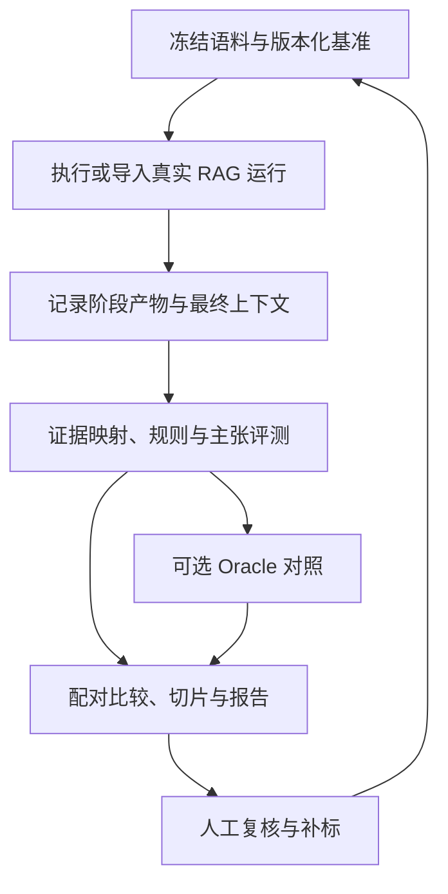

# RAG 测评框架 v2：核心设计精简版

版本：2.0（精简版）｜日期：2026-11-06

适用范围：企业知识库 RAG 的组件比较、离线回归与线上监控。本文保留核心设计决策；完整指标口径、字段示例、专项套件和来源见 [完整 v2](./RAG测评设计_v2.md)。

## 1. 目标与原则

框架回答三个问题：系统是否正确完成任务；组件变更带来什么收益与代价；失败发生在哪个环节，有什么证据支持诊断。

核心原则：

- **参考稳定**：黄金证据绑定源文版本，不绑定待测系统的 chunk ID。
- **维度独立**：正确、完整、忠实、证据充分和引用有效分别评价。
- **比较公平**：固定数据、权限、配置和预算；跨切块优先比较相同上下文预算。
- **结果可审计**：保留真实输入输出、裁判版本、依据与不确定状态。
- **范围可控**：首版采用轻量执行器与插件，不先建设通用工作流引擎。

## 2. 总体架构

采用五个逻辑模块：

| 模块 | 核心职责 |
|---|---|
| 数据与证据库 | 冻结语料、保存测试题、参考事实与来源位置，管理版本 |
| Adapter 与运行器 | 执行/导入系统，记录真实链路，控制并发、超时、重试和成本 |
| 证据映射器 | 将稳定证据映射到解析、候选、重排和最终上下文 |
| Evaluator | 规则验证、主张提取、模型判断及人工校准 |
| 诊断与报告 | 故障线索、有限对照、配对统计、切片与发布门禁 |

七阶段是报告视图：**解析 → 切块 → 表征索引 → 查询处理 → 检索重排 → 组装生成 → 工程安全**。循环检索和并行分支通过多个 span 记录，框架无需接管业务流程。

## 3. 核心数据与证据

### 3.1 最小数据对象

| 对象 | 必要信息 |
|---|---|
| CorpusSnapshot | 文档版本、有效时间、访问策略 |
| TestCase | query/会话、时间/权限、预期行为、必需答点、参考答案或验证规则 |
| EvidenceUnit | 稳定证据身份、源文位置、事实属性、审定状态 |
| ExperimentManifest | 数据/语料、系统、裁判、映射器、预算及环境版本 |
| Run/Trace | 实际候选、排序、最终模型输入、输出、错误和计量 |
| Judgment | 指标及版本、分数/状态、分母、判定依据与证据 |

普通系统调用只能接收用户输入与业务配置；参考答案、黄金证据和裁判结果不传入被测系统。Oracle 是显式例外。

### 3.2 证据定位

文本首版使用：

**文档 revision + 固定原文摘录 quote + 可用章节/页范围 + 前后文消歧。**

字符 offset 可选；图像、表格保留稳定 asset、行列关系和可靠页/区域。DOCX 等页码依赖渲染时，应绑定冻结渲染版本。URL 仅是访问地址，hash 仅负责校验、去重和缓存。

映射先精确、再保守归一化，必要时产生模糊候选；年份、数字、单位、否定等实质差异不能被忽略。

必须区分：

- **确认缺失**：源文事实确实未出现在当前阶段产物，计为该阶段缺失。
- **匹配不确定**：无法确认存在、缺失或具体位置，报告未知与测量覆盖，不能直接算漏召回。

支持多套充分证据，例如 {E1,E2} 或 {E3,E4} 任一组均可。按必要事实去重；核心集补充已知替代组，扩展集不要求穷举。未标注的新证据记为 unjudged，补标后发布新版本。

## 4. 基准数据集构建

采用三层数据：

| 数据层 | 用途 |
|---|---|
| 人工审定核心集 | 独立核验原文，校准裁判、验证回归及发布质量 |
| 合成扩展集 | 扩大任务、模态、难度和压力覆盖，保留自动验证标签 |
| 线上回流集 | 真实问题与失败案例，记录抽样来源，复核后进入新基准 |

构建流程：

**冻结源文 → 提取事实、条件与位置 → 建立证据关系 → 按场景生成问题 → 核验答案与充分证据 → 人工抽检/仲裁 → 去重、分组切分、冻结版本。**

关键约束：

1. 人工核心集回到原始文件核查，不能只用待测 parser 的输出制造全部 gold。
2. 多跳题保存必要证据依赖；两段相似材料不自动构成多跳。
3. 数值题验证输入值、实体、期间和单位，再执行白名单运算；答案数字无须逐字出现在 OCR 中。
4. 无答案相对于授权语料、时间和允许工具定义；检索无命中不证明整库无答案。
5. 按文档族、会话或时间分组切分，调参使用 dev，最终结论用未参与调优的 holdout。
6. 多模型一致不等于真值；没有人工预算时，产物称为自动验证候选集。

多模态保留原图与结构化提取结果，caption 不作为唯一事实通道。来源是图表与生成器实际收到图像分别记录；图片引用需验证支撑内容，不能只匹配 URL。

## 5. 核心指标体系

| 阶段 | 核心评价 |
|---|---|
| 解析清洗 | 关键字段/关系保真、有效内容误删；版面、阅读顺序、OCR、表格作为专项 |
| 切块 | 相同预算下的必要事实覆盖、充分证据完整、截断损失与索引成本 |
| 表征索引 | 领域检索质量、ANN 对 exact 的保真、量化影响及资源开销分别测量 |
| 查询处理 | 实体/时间/否定等约束保留、路由质量、重写前后实际收益 |
| 检索重排 | Recall/Hit/MRR/nDCG、预算内证据覆盖、充分性及排序/压缩损失 |
| 生成引用 | 正确、完整、忠实、引用支持/覆盖、任务遵守及拒答行为 |
| 工程安全 | 成功/超时/错误、尾延迟、成功任务成本、更新时效与权限边界 |

最重要的口径：

- **Hit@K**：是否命中至少一项已标相关证据；**Recall@K**：已标相关证据被找回的比例。排序评价必须固定单元和标注范围。
- **预算内证据覆盖**：已知充分组中，覆盖最好一组的必要事实比例；重复内容不加分。
- **充分证据完整**：是否完整覆盖至少一套审定充分组。未覆盖已知组不证明不存在未标替代路径。
- **忠实度**：输出中可验证事实主张受实际输入上下文支持的比例；不等于真实正确或答全。
- **完整性**：必需答点满足比例；额外错误仍影响正确性。
- **引用支持**：该主张所附引用能否联合支持它；引用覆盖检查需要引用的主张是否获得有效来源。
- **拒答**：同时看可答题误拒、不可答题错误作答，以及回答覆盖率与错误风险。纯拒答没有事实主张时，忠实度不适用。
- **成本延迟**：报告 E2E 和 p50/p95/p99，系统、索引与评测成本分开。成功任务成本包含失败请求开销。

HNSW 本身不是量化算法；ANN 近邻复现不代表业务相关性。语义相似度、聚类或“相关片段很多”都不能代替任务成功。

## 6. 接入与执行

按能力开放三个基本入口：

| 接口/能力 | 作用 |
|---|---|
| run 或 import_run | 执行系统或导入已有运行 |
| retrieve_only / trace_stages | 可选，支持检索专项与阶段诊断 |
| generate_with_context | 可选，复用原生成配置进行 Oracle 对照 |

支持全量离线、仅检索、固定上下文生成、历史 Trace 审计和线上抽样。指标按依赖调度：只有 query 不能计算忠实度，没有 qrels 不能假称得到可靠召回。

执行顺序：**校验计划与版本 → 运行/导入 → 保存真实产物 → 映射证据与提取主张 → 评价 → 可选干预 → 配对报告。**

原始候选、重排结果、最终上下文分别保存。“检索到过”不等于“模型看到过”。预算记录文本 tokenizer、图像资源、轮次、输出与超时；跨模态不能只靠相同文本 token 宣称同资源。

每项 Judgment 使用以下状态：ok、not_applicable、not_computable、inconclusive、error。报告有效样本数、分母及覆盖：

- 被测服务超时等是任务失败。
- 评测器失败或证据判断未知是测量未知。
- 不静默删样本，不将未知填为零或满分；覆盖不足不能自动通过门禁。

## 7. 裁判与故障诊断

### 7.1 裁判

确定规则优先验证格式、数值、单位和可解析引用；模型用于主张提取、支持判断与综合 rubric。使用独立人工样本校准，记录混淆矩阵、各类误判、主张提取错误与重要切片。

冻结模型、prompt/rubric、阈值及预处理版本。Pairwise judge 随机化左右顺序并检查偏差。异构模型和低温采样帮助发现/控制误差，但不保证独立与正确。

### 7.2 诊断与 Oracle

输出“症状 → 假设 → 阶段观察 → 干预效果”，允许多个故障，不强制单根因。

首版有接口时做 Oracle：固定 query、会话、模型、模板、权限、工具与输出设置，仅将声明的上下文换成审定充分证据，记录长度和顺序变化。失败样本优先，另抽取部分通过/随机样本检查干预偏差。

| 结果 | 可报告的结论 |
|---|---|
| 原错、Oracle 对 | 在该上下文替换条件下恢复，排查证据供应或利用 |
| 原错、Oracle 错 | gold 条件下仍失败，检查生成、输入、模板及标注 |
| 原对、Oracle 错 | 干预退化，检查配置一致性、gold 和波动 |

恢复不证明检索必然漏召回：原证据可能已存在，只是噪声、位置或生成随机性不同。无法复用原配置时，称为替代生成实验。通用任意阶段回放放后续。

## 8. 对比、门禁与线上回流

同一用例做 A/B 配对，固定数据/语料、权限、预算和裁判；按文档族或会话处理样本相关性。报告差异、置信区间、重要切片、测量覆盖和成本。重复运行不当成独立新题。

发布门禁采用 **pass / fail / inconclusive**：先满足业务正确性、权限、安全、覆盖及资源约束，再比较质量—成本—延迟。阈值与非劣容忍度预先确定，不靠单一加权总分或微小均分差下结论。

线上无参考分数仅作代理监控，不宣称真实准确率。随机样本与难例队列分开，经过原文/权限/时间核验后进入新数据集版本：

**生产 Trace → 抽样评价 → 人工复核 → 新基准 → 离线验证。**

## 9. MVP 与后续范围

| 阶段 | 交付重点 |
|---|---|
| P0：可信闭环 | 稳定原文锚点、人工核心集、版本契约、一个接入系统、核心指标、裁判校准、配对与覆盖报告；有能力则加 Oracle |
| P1：深入诊断 | 解析专项、多模态区域、有限阶段干预、多轮/冲突与更新、安全专项 |
| P2：按收益扩展 | 通用回放、agentic 轨迹、更多替代证据发现、PPI 与复杂成本优化 |

首版采用单包/CLI、JSONL/JSON 文件及有限并发；按需复用 LangSmith/Phoenix 的实验与追踪、Ragas/DeepEval/RAGChecker 的评价能力，不将多个平台列为硬依赖。

首版验收底线：改切块不改 gold；记录真实最终上下文；缺条件不伪造指标；数值验证保留实体/单位关系；人工校准可查；未知不自动通过；Oracle 不输出确定根因。

所有产物、缓存和外部 judge 调用遵守租户权限、保留与出域策略，凭据不入日志。详细实施与验收以 [完整 v2](./RAG测评设计_v2.md) 为准。
